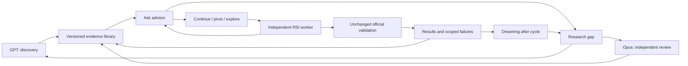

# Library RSI

Status: initial DQI seeding in progress, 24 October 2026. Production integration remains disabled.

The library gives independent DreamRSI workers access to research advice. GPT-6.1 Sol and Opus 5.5 build a shared evidence base, assess whether an approach is worth continuing, and suggest concrete tests. Workers keep control of their branches and can decline advice or explore an unrelated architecture.

“Shared” here means shared among branches of one project. Independent projects
(DQI, forecasting, RCA, or two separate DQI efforts) require separate libraries,
research context, histories and controllers. See the [project architecture](../architecture.md)
for the intended isolation model and current implementation gaps.

## Operation

Begin with a bounded seed batch. GPT discovers and organizes methods; Opus independently challenges assumptions and compatibility. These roles can rotate. Thereafter researchers answer questions, investigate gaps, and follow up useful findings. They need not run continuously or generate papers simply to keep busy.

A worker calls `ask_advisor` at attempt start or when blocked, supplying the task contract, parent approach, bottleneck, and relevant failures. The advisor searches versioned entries and compatible cached answers first. A missing answer becomes a bounded research question. Pending research must not block unrelated branch progress.

The response assesses the current architecture and recommends **continue**, **pivot**, or **explore**. It can explicitly recommend replacing a poor architecture. It provides two or three concrete directions, primary sources, compatibility issues, the opportunity and uncertainty, and the cheapest useful falsification test. It distinguishes evidence from predictions. Repeated recommendations can be useful on different parents; workers do not claim exclusive ownership of a paper or method.

## Evidence and revisions

`scripts/library_rsi/store.py` implements a SQLite WAL store with immutable content-hashed method revisions, sources, evidence, reviews and events, plus local full-text search. Search needs no model call. Human-readable frozen exports live under `library/dqi/`; the working database lives under `runs/library-rsi/`. Credentials never belong in either.

Each method records mechanism, family, primary citations and pinned source commits where applicable, assumptions, compatibility, continue/pivot/explore conditions, smallest test, risks, open questions and scoped evidence. Attribution and license obligations accompany reused implementations.

Evidence levels are `published_claim`, `algebra_checked`, `microcircuit_checked`, `development_verified`, and `independently_verified`. A second model agreeing with a paper is still a published claim. A successful arithmetic test is not an official circuit score. Verified entries require an actual full official PASS receipt; independent verification additionally requires a held-out receipt. Receipt hashes are retained. Integrated candidate evidence does not certify every component in isolation.

Keep negative findings with their parameter regime and cause. One failed implementation is not a proof of impossibility. Provider errors and interrupted work are infrastructure outcomes, not evidence against a method. Revisions preserve earlier claims; a review records disagreements and a distinguishing test rather than silently replacing history.

## Branching and dreaming

There is no central experiment queue assigning architectures to RSI workers, no mandatory worker lease, and no exclusive paper assignment. Research assignments can be coordinated to avoid redundant strong-model searches. Optional exact-experiment deduplication can flag waste without forbidding replication or independent exploration.

Independent branches continue on their existing schedules. The library does not introduce a wave barrier. Dreaming still consumes the completed cycle and can retain useful candidates, compare failures, extract components, propose combinations, and request further research. Every combination needs fresh verification; compatibility cannot be inferred from the component scores.

For the first controlled integration freeze a library snapshot per cycle. Log snapshot, retrieved revisions, advice, parent source hash and actual use at every node. Live advice during a cycle is a separate information-flow extension and must be labelled `library_rsi`, rather than reported as vanilla DreamRSI.

## Implementation boundary and tests

The store and initial seed are implemented. The isolated five-branch trial uses
`scripts/library_rsi/server.py` for `ask_advisor`, public-source retrieval and
existing sandbox tools. Questions bind to the server's branch and frozen
snapshot, are cached by exact question/context, and reach a scoped GPT advisor
mailbox. The tool waits up to three minutes, then returns pending status plus
retrieved evidence so workers can continue useful work. Repeating the same
question retrieves its eventual answer. This experimental advisor is currently
a supervised native researcher, not a deployed always-on model service.

`scripts/library_rsi/trial.py` starts five separate MiniMax sessions, each with
one attempt from the official reference. It automatically grades each frozen
candidate on development and fresh-salt checks. It does not enable the advisor
in the existing campaign. Automatic result ingestion into curated method
revisions and general campaign integration remain proposed interfaces.

Preserve the existing blind researcher-to-worker reproduction tests: their workers and researcher must never read this seeded library or the known private solution. Passing requires the same frozen candidate to meet the reward target in full development and fresh-salt verification, with provenance review. This checks whether workers can implement literature guidance, not the benefit of live advice.

After reproduction passes, compare matched vanilla and snapshot-advised runs. Measure verified quality, time to first useful candidate, time wasted before first test, researcher and worker cost, validation load, and branch diversity. A reproduction success alone does not establish that Library RSI improves campaign throughput. Automatic production enablement remains off.

Research tools may read public sources and scoped task material. Executable candidate diagnostics retain existing credential-free, network-free sandboxes and unchanged official files, time, memory, and validation-concurrency limits. Strong-model OAuth research uses an isolated client/profile so current workers are unaffected.
